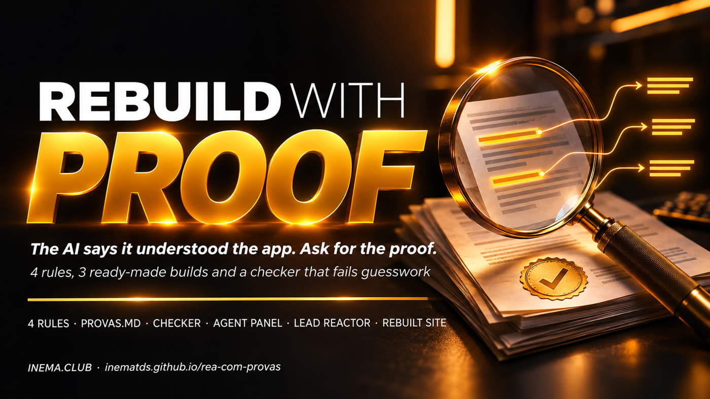

# REA with proof

[](https://inematds.github.io/rea-com-provas/guia/en/)

**🇧🇷 [Português](README.md) · 🇺🇸 [English](README.en.md) · 🇪🇸 [Español](README.es.md)**

> **The AI says it understands the app. Ask for proof.**

## What it is

**REA with proof** is a free, open kit for people who use an AI agent (Claude Code, Codex, or the dsh harness) to study an app and build their own version. The problem: the agent says it understands how the app works and makes up what it hasn’t seen. The kit includes 4 rules, 3 ready-to-use prompts (agent dashboard, lead reactor, and rebuilt website), and a Python checker that rejects the proof file when evidence is missing. To use it, you need Python 3 and an AI agent in your terminal.

## 📖 User guide

Full guide (landing page + step-by-step instructions): **https://inematds.github.io/rea-com-provas/guia/en/**

> [!WARNING]
> **Safety and licensing.** Use only with **software you own** or **open source software whose license allows
> study** (MIT, Apache-2.0, BSD, GPL, MPL…). Studying is not copying: your version is written from
> scratch, with your own name, text, and visuals. Run the agent in a separate folder, without passwords,
> keys, or customer data. Details in [REGRAS.md](REGRAS.md) (in Portuguese).

## The 4 rules

1. **Always request the `provas.md` proof file**: each conclusion must cite the file/snippet that proves it, along with the section "O que NÃO deu para provar".
2. **Focus on the app’s own code**, not bundled libraries (tell the agent to ignore `node_modules`, `vendor`, `site-packages`).
3. **Only use software you own or open source software whose license allows study.** Then build YOUR version, with your own name and visuals.
4. **Describe the visuals in detail** (colors, fonts, motion) in a design brief.

## What’s in the kit

| File | What it’s for |
|---|---|
| [`REGRAS.md`](REGRAS.md) (in Portuguese) | The 4 rules and the safety and licensing notice |
| [`prompts/a-painel-de-agentes.md`](prompts/a-painel-de-agentes.md) (in Portuguese) | Build A: dashboard with 6 active agents for a business + command box |
| [`prompts/b-reator-de-leads.md`](prompts/b-reator-de-leads.md) (in Portuguese) | Build B: lead arrives → qualify, respond, schedule, follow up → celebrate |
| [`prompts/c-site-refeito.md`](prompts/c-site-refeito.md) (in Portuguese) | Build C: map YOUR website and rebuild it as a premium version |
| [`provas/MODELO-provas.md`](provas/MODELO-provas.md) | Proof file format |
| [`confere_provas.py`](confere_provas.py) | Checker: score 0–10, APROVADO/REPROVADO, and what’s missing |
| [`brief/MODELO-brief-design.md`](brief/MODELO-brief-design.md) | Design brief with a completed example in the INEMA style |
| [`exemplos/`](exemplos/) | `provas-boa.md` (approved), `provas-ruim.md` (rejected), and the real run |
| [`tests/`](tests/) | Checker tests, no internet required |

The kit comes configured with INEMA as the example (brief in the INEMA style, real run on inema.club). Replace the [bracketed text] in the prompts and the brief with your business details.

## The checker

```bash
python3 confere_provas.py provas.md          # text report
python3 confere_provas.py provas.md --json   # same result in JSON
```

It rejects (exit code 1) when the section "O que NÃO deu para provar" is missing or empty,
when a conclusion does not cite a file/snippet, or when all references point to
libraries (`node_modules`, `vendor`, `site-packages`…). It approves with exit code 0. Could not read: exit code 2.
The checker validates the format; opening 2 or 3 pieces of evidence and checking that the cited snippet is there is still up to you.

## The process, from start to finish

Who does what: 🧠 you (with the agent open) · ⚙️ script · 🤖 AI agent (Claude Code, Codex, or dsh)

| # | Step | Command | Who |
|---|---|---|---|
| 1 | Download the kit and run the tests | `git clone https://github.com/inematds/rea-com-provas.git && cd rea-com-provas && python3 -m unittest discover tests` | ⚙️ |
| 2 | (Optional) Install REA + harness | guide https://inematds.github.io/rea-sem-travas/guia/ | 🧠 |
| 3 | Choose the target and check the license | `cat ~/estudo/app/LICENSE` | 🧠 |
| 4 | Fill in the design brief | `cp brief/MODELO-brief-design.md ~/estudo/brief.md` | 🧠 |
| 5 | Paste one of the builds from `prompts/` into the agent (phase 1: study) | `cd ~/estudo && claude` (or `codex`) | 🧠 → 🤖 |
| 6 | The agent delivers `provas.md` and runs the checker until APROVADO | `python3 confere_provas.py provas.md` | 🤖 + ⚙️ |
| 7 | Check 2 or 3 pieces of evidence by hand and give the go-ahead | write `pode construir` | 🧠 |
| 8 | The agent builds your version (phase 2) | — | 🤖 |
| 9 | Open it, test it, and request adjustments | open the generated `index.html` | 🧠 |

## Real test (08/11/2026)

Build C ran in Claude Code (using the subscription) with the inema.club website as "your website," approach 1 (saved HTML, without REA), phases 1 and 2 at once:

- **23 conclusions** in `provas.md`; checker: **NOTA 10/10 — APROVADO**;
- **4 out of 4** pieces of evidence opened by hand (lines 72, 113, 144, and 161 of the saved HTML) contained the cited snippet;
- **472 s** (7 min 52 s) and 42 agent turns for both phases;
- produced a 94 KB `index.html`, with no horizontal scrolling at 390 px and 1440 px.

Everything is in [`exemplos/rodada-real/`](exemplos/rodada-real/): the prompt used, `provas.md`, the saved HTML, and the new version.

## Tests

```bash
python3 -m unittest discover tests     # or: pytest
```

No internet required. They cover: missing "O que NÃO deu para provar" section, empty section, conclusion without a
reference, references only in `node_modules`/`vendor`, EN/ES titles, blank template, and both
examples run from the command line.

## See also

- [What is REA](https://inematds.github.io/rea-engenharia-reversa/guia/) — the reverse engineering tool behind it all.
- [REA without lock-in](https://inematds.github.io/rea-sem-travas/guia/) — install an open model + harness + REA on your computer.

## License

MIT. Free, open content from [INEMA.CLUB](https://inema.club).
