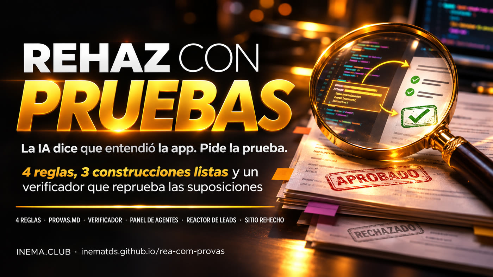

# REA con pruebas

[](https://inematds.github.io/rea-com-provas/guia/es/)

**🇧🇷 [Português](README.md) · 🇺🇸 [English](README.en.md) · 🇪🇸 [Español](README.es.md)**

> **La IA dice que entendió la app. Pide la prueba.**

## Qué es

**REA con pruebas** es un kit abierto y gratuito para quienes usan un agente de IA (Claude Code, Codex o el harness dsh) para estudiar una app y hacer su propia versión. El problema: el agente dice que entendió cómo funciona la app e inventa lo que no vio. El kit incluye 4 reglas, 3 solicitudes listas (panel de agentes, reactor de leads y sitio web rehecho) y un verificador en Python que rechaza el archivo de pruebas cuando faltan pruebas. Para usarlo, necesitas Python 3 y un agente de IA en la terminal.

## 📖 Guía de uso

Guía completa (landing + paso a paso): **https://inematds.github.io/rea-com-provas/guia/es/**

> [!WARNING]
> **Seguridad y licencia.** Úsalo solo con **software propio** o **de código abierto cuya licencia permita
> estudiarlo** (MIT, Apache-2.0, BSD, GPL, MPL…). Estudiar no es copiar: tu versión se escribe desde
> cero, con tu nombre, tus textos y tu diseño. Ejecuta el agente en una carpeta separada, sin contraseñas,
> claves ni datos de clientes. Más detalles en [REGRAS.md](REGRAS.md) (en portugués).

## Las 4 reglas

1. **Siempre pide el archivo de pruebas `provas.md`**: cada conclusión debe incluir el archivo o fragmento que la prueba, además de la sección "O que NÃO deu para provar".
2. **Enfócate en el código de la propia app**, no en las bibliotecas incluidas (indica que ignore `node_modules`, `vendor`, `site-packages`).
3. **Solo software propio o de código abierto cuya licencia permita estudiarlo.** Después, construye TU versión, con tu nombre y diseño.
4. **Describe el diseño en detalle** (colores, fuentes, movimiento) en un brief de diseño.

## Qué incluye el kit

| Archivo | Para qué sirve |
|---|---|
| [`REGRAS.md`](REGRAS.md) (en portugués) | Las 4 reglas y el aviso de seguridad y licencia |
| [`prompts/a-painel-de-agentes.md`](prompts/a-painel-de-agentes.md) (en portugués) | Construcción A: panel con 6 agentes activos para un negocio + caja de comandos |
| [`prompts/b-reator-de-leads.md`](prompts/b-reator-de-leads.md) (en portugués) | Construcción B: llega un lead → calificar, responder, agendar, dar seguimiento → celebrar |
| [`prompts/c-site-refeito.md`](prompts/c-site-refeito.md) (en portugués) | Construcción C: mapear TU sitio y rehacerlo en una versión premium |
| [`provas/MODELO-provas.md`](provas/MODELO-provas.md) | Formato del archivo de pruebas |
| [`confere_provas.py`](confere_provas.py) | Verificador: nota de 0 a 10, APROVADO/REPROVADO y lo que falta |
| [`brief/MODELO-brief-design.md`](brief/MODELO-brief-design.md) | Brief de diseño con ejemplo completo según el estándar INEMA |
| [`exemplos/`](exemplos/) | `provas-boa.md` (aprobada), `provas-ruim.md` (reprobada) y la ronda real |
| [`tests/`](tests/) | Pruebas del verificador, sin internet |

El kit viene configurado con INEMA como ejemplo (brief según el estándar INEMA, ronda real en el sitio inema.club). Cambia los [corchetes] de los prompts y el brief para adaptarlos a tu negocio.

## El verificador

```bash
python3 confere_provas.py provas.md          # relatório em texto
python3 confere_provas.py provas.md --json   # mesmo resultado em JSON
```

Rechaza (código de salida 1) cuando falta la sección "O que NÃO deu para provar" (o está vacía),
cuando una conclusión no cita un archivo o fragmento, o cuando todas las referencias apuntan a
bibliotecas (`node_modules`, `vendor`, `site-packages`…). Aprueba con el código 0. Si no pudo leer: código 2.
El verificador comprueba el formato; abrir 2 o 3 pruebas y comprobar que el fragmento esté ahí sigue siendo tarea tuya.

## El proceso de principio a fin

Quién participa: 🧠 tú (con el agente abierto) · ⚙️ script · 🤖 agente de IA (Claude Code, Codex o dsh)

| # | Paso | Comando | Quién |
|---|---|---|---|
| 1 | Descargar el kit y ejecutar las pruebas | `git clone https://github.com/inematds/rea-com-provas.git && cd rea-com-provas && python3 -m unittest discover tests` | ⚙️ |
| 2 | (Opcional) Instalar REA + harness | guía https://inematds.github.io/rea-sem-travas/guia/ | 🧠 |
| 3 | Elegir el objetivo y comprobar la licencia | `cat ~/estudo/app/LICENSE` | 🧠 |
| 4 | Completar el brief de diseño | `cp brief/MODELO-brief-design.md ~/estudo/brief.md` | 🧠 |
| 5 | Pegar una construcción de `prompts/` en el agente (fase 1: estudiar) | `cd ~/estudo && claude` (o `codex`) | 🧠 → 🤖 |
| 6 | El agente entrega `provas.md` y ejecuta el verificador hasta obtener APROVADO | `python3 confere_provas.py provas.md` | 🤖 + ⚙️ |
| 7 | Revisar 2 o 3 pruebas a mano y dar luz verde | escribir `pode construir` | 🧠 |
| 8 | El agente construye tu versión (fase 2) | — | 🤖 |
| 9 | Abrir, probar y pedir ajustes | abrir el `index.html` generado | 🧠 |

## Prueba real (08/11/2026)

La construcción C se ejecutó en Claude Code (con la suscripción), con el sitio inema.club como «tu sitio», método 1 (HTML guardado, sin REA), fases 1 y 2 de una vez:

- **23 conclusiones** en `provas.md`; el verificador: **NOTA 10/10 — APROVADO**;
- **4 de 4** pruebas revisadas a mano (líneas 72, 113, 144 y 161 del HTML guardado) tenían el fragmento citado;
- **472 s** (7 min 52 s) y 42 turnos del agente para las dos fases;
- se generó un `index.html` de 94 KB, sin desplazamiento horizontal en 390 px ni en 1440 px.

Todo está en [`exemplos/rodada-real/`](exemplos/rodada-real/): la solicitud utilizada, `provas.md`, el HTML guardado y la nueva versión.

## Pruebas

```bash
python3 -m unittest discover tests     # ou: pytest
```

Sin internet. Cubren: falta la sección «no se pudo probar», sección vacía, conclusión sin
referencia, referencias solo en `node_modules`/`vendor`, títulos en EN/ES, plantilla en blanco y los
dos ejemplos desde la línea de comandos.

## Ver también

- [Qué es REA](https://inematds.github.io/rea-engenharia-reversa/guia/) — la herramienta de ingeniería inversa detrás de todo.
- [REA sin trabas](https://inematds.github.io/rea-sem-travas/guia/) — instala un modelo abierto + harness + REA en tu computadora.

## Licencia

MIT. Contenido abierto y gratuito de [INEMA.CLUB](https://inema.club).
